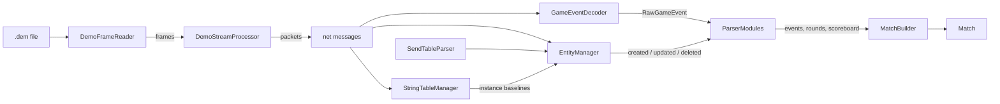

# cs2-demoparser

A Java 27 library that parses Counter-Strike 2 demo files (`.dem`) into a single `Match` object:
demo metadata, players, the final result, every round, the scoreboard and a chronological timeline
of what happened when.

- No runtime dependencies (Protobuf, Snappy and the bit stream format are decoded by the library itself)
- Streams the demo frame by frame, so a 250 MB demo is never loaded into memory as a whole
- A full matchmaking demo parses in roughly 2–3 seconds
- Modular: what is extracted is defined by pluggable modules, and you can add your own

> [!WARNING] 
> **This demo parser has been fully created by AI.** The code, tests and documentation were written by
> an AI model (Claude). They were checked against a small set of test demos, but have not been
> reviewed line by line by a human. Validate the results for your use case before relying on them.

## Usage

```java
Match match = DemoParser.create().parse(Path.of("match.dem"));

match.mapName();          // "de_dust2"
match.finalScore();       // "13:7" (T:CT at the end of the match)
match.winner();           // Optional<TeamResult>
match.parseDuration();    // how long parsing took, e.g. PT2.4S

for (ScoreboardEntry e : match.scoreboard().entries()) {
    System.out.printf("%-20s %2d/%2d/%2d  ADR %.1f%n",
            e.player().name(), e.kills(), e.deaths(), e.assists(), e.adr());
}

for (Round round : match.rounds()) {
    System.out.println(round.number() + ": " + round.winner() + " (" + round.reason() + ")");
}

List<KillEvent> headshots = match.kills().stream().filter(KillEvent::headshot).toList();
List<GameEvent> round5 = match.eventsInRound(5);

for (MatchHalf half : match.halves()) {
    System.out.println("Half " + half.number() + " T: " + half.terrorists() + " CT: " + half.counterTerrorists());
}
Team side = match.halves().getFirst().sideOf(player);   // side of a player in the first half
```

`parse` also accepts an `InputStream`. A `DemoParser` is immutable and thread safe, so one instance
can parse many demos, also in parallel (see [Parallel parsing](#parallel-parsing)).

## The `Match` entity

| Property        | Content                                                                                   |
|-----------------|-------------------------------------------------------------------------------------------|
| `info`          | Map, server, build number, tick rate, number of ticks, playback duration                  |
| `players`       | Everyone who played on T or CT (SteamID, name, bot flag)                                  |
| `teams`         | Per side: name, total score, score per half and in overtime, players                      |
| `rounds`        | Start / freeze end / end tick, winner, end reason, score after the round, kills, players per side |
| `halves`        | Each half (incl. overtime halves): its rounds, the players on T and CT, rounds won per side |
| `scoreboard`    | K/D/A, headshots, damage, ADR, utility damage, flashed enemies, MVPs, score, 3k/4k/5k     |
| `events`        | Timeline of typed events (`KillEvent`, `BombPlantedEvent`, `RoundEndEvent`, ...) by tick  |
| `warnings`      | Problems that were skipped while parsing (empty for a healthy demo)                       |
| `parseDuration` | How long the parser took to read and analyze the demo                                     |

Every event implements `GameEvent` and knows its `tick()` and `round()` (`0` = warmup).
`match.info().tickToTime(tick)` converts a tick to the time since the start of the demo.

## Modules

`DemoParser.create()` uses the default modules. Use the builder to change the set:

```java
DemoParser parser = DemoParser.builder()
        .withDefaultModules()
        .module(WeaponFireModule::new)                          // every shot
        .module(PlayerPositionModule::new)                      // positions, 4 samples/s
        .module(() -> new PlayerPositionModule(1, true))         // ...or every tick, incl. warmup
        .module(() -> new GenericEventModule(Set.of("item_pickup")))
        .module(MyModule::new)                                  // your own
        .strict(true)                                           // fail instead of collecting warnings
        .build();
```

| Module                 | Default | Produces                                                                 |
|------------------------|:-------:|--------------------------------------------------------------------------|
| `RoundModule`          |   yes   | Match start/end, round start/freeze end/end, `Match.rounds`, `Match.halves` |
| `CombatModule`         |   yes   | Kills, damage (`PlayerHurtEvent`), flashes (`PlayerBlindEvent`)          |
| `BombModule`           |   yes   | Plant/defuse (begin and done), explosion, bomb dropped / picked up       |
| `GrenadeModule`        |   yes   | HE, flash, smoke, decoy detonations and molotov/incendiary fires         |
| `PlayerActivityModule` |   yes   | Team changes, disconnects                                                |
| `ScoreboardModule`     |   yes   | `Match.players`, `Match.teams`, `Match.scoreboard`                       |
| `WeaponFireModule`     |   no    | `WeaponFireEvent` for every shot (thousands per demo)                    |
| `PlayerPositionModule` |   no    | `PlayerPositionEvent`: position, view angles and health of every living player, sampled every 16 ticks by default (~60,000 per demo) |
| `GenericEventModule`   |   no    | Raw `GenericGameEvent`s for all (or selected) game events                |

A module implements `ParserModule` and overrides only the callbacks it needs:

```java
class ClutchModule implements ParserModule {
    @Override
    public void onGameEvent(RawGameEvent event, ParserContext ctx) {
        if (event.name().equals("player_death")) {
            Player victim = ctx.playerBySlot(event.getInt("userid", -1));
            // ... analyze, then ctx.emit(new MyEvent(...)) to add it to the timeline
        }
    }

    @Override
    public void onEntityUpdated(Entity entity, Set<String> changed, ParserContext ctx) {
        // react to entity state, e.g. entity.getInt("m_iHealth", 0) of a CCSPlayerPawn
    }
}
```

Modules are passed as suppliers because they keep per-demo state; a fresh instance is created for
every parse. They are notified in the order they were added. `RoundModule` maintains
`ParserContext.currentRound()`, so it should come before modules that tag events with a round.

## Parallel parsing

The parser has no parallel mode of its own, but it is safe to parse **several demos at the same time**
with one shared `DemoParser`:

```java
DemoParser parser = DemoParser.create();   // one instance for all threads

List<Match> matches = demoFiles.parallelStream()
        .map(parser::parseUnchecked)       // UncheckedIOException instead of IOException
        .toList();

// or with an executor, e.g. to limit the number of threads
try (ExecutorService pool = Executors.newFixedThreadPool(Runtime.getRuntime().availableProcessors())) {
    List<Future<Match>> futures = demoFiles.stream()
            .map(file -> pool.submit(() -> parser.parse(file)))
            .toList();
    for (Future<Match> future : futures) {
        Match match = future.get();
        // ...
    }
}
```

Why this is safe:

- `DemoParser` only holds the module suppliers and the strict flag and never changes after `build()`.
- Every `parse` call creates its own analyzer with its own entity state, string tables and event decoder,
  plus fresh module instances from the suppliers.
- The library has no mutable static state.
- The returned `Match` is immutable and can be read from any thread.

A **single demo is always parsed on one thread**. A demo is one sequential bit stream and every entity
update is a delta on top of the previous state, so it can not be split and decoded from the middle.

Things to keep in mind:

- **Module suppliers must create new instances.** `.module(MyModule::new)` is fine; a supplier that returns
  the same object every time (`.module(() -> sharedModule)`) shares that module between parallel parses,
  so it would have to be thread safe.
- **CPU:** parsing is CPU-bound, so throughput tops out at about one demo per core. For many demos use a
  pool sized to the number of cores rather than one thread per demo.
- **Memory:** each running parse holds a complete entity state and its growing event list (tens of MB per
  demo, more with `PlayerPositionModule` or `WeaponFireModule`). Raise the heap (`-Xmx`) when parsing
  many demos at once.

Measured with the three test demos on a 16-core machine: 7.5 s one after another, 2.7 s in parallel. The
parallel run takes about as long as the slowest single demo, and the results are identical.

## How the parser works



### 1. Demo container (`businesslogic.demo`)

A CS2 demo starts with the magic `PBDEMS2\0` and two offsets, followed by a sequence of frames. Each
frame is `varint command, varint tick, varint size, payload`; if the command has the flag `64`
set, the payload is Snappy compressed. `DemoFrameReader` reads one frame at a time from a buffered
stream (`io.Snappy` decompresses). A demo that was cut off mid-frame simply ends there.

The important frame types are:

| Frame                           | Content                                                       |
|---------------------------------|---------------------------------------------------------------|
| `FILE_HEADER`, `FILE_INFO`      | Map, server, build; playback time and ticks                   |
| `SEND_TABLES`                   | The layout of every networked entity class                    |
| `CLASS_INFO`                    | Class id → class name                                         |
| `PACKET`, `SIGNON_PACKET`       | The actual game data as network messages                      |
| `FULL_PACKET`, `STRING_TABLES`  | Periodic snapshots (used for seeking; mostly redundant)       |

### 2. Network messages

A packet's payload is a bit stream of network messages, each `ubitvar type, varint size, protobuf`.
`DemoStreamProcessor` splits them and hands them to `DemoAnalyzer`, which routes the ones the
library needs. All protobuf messages are read with the small streaming decoder `io.ProtoReader`
(no generated classes; only the fields the parser uses are decoded).

| Message                              | Handled by             |
|--------------------------------------|------------------------|
| `svc_ServerInfo`                     | tick interval, max classes |
| `svc_CreateStringTable` / `Update…`  | `StringTableManager`   |
| `svc_PacketEntities`                 | `EntityManager`        |
| `GE_Source1LegacyGameEventList`      | `GameEventDecoder` (event layouts) |
| `GE_Source1LegacyGameEvent`          | `GameEventDecoder` → modules |

### 3. Game events (`businesslogic.gameevents`)

The server first announces every event type with its key names (`player_death`: `userid`,
`attacker`, `weapon`, `headshot`, ...). Each later event only carries the type id and the values in
the same order. `GameEventDecoder` combines both into a `RawGameEvent` (name, tick, key → value).

In CS2, the `userid` of an event is the *player slot*. The player controller of slot `n` is the
entity with index `n + 1`, which is how `ParserContext.playerBySlot` resolves names and SteamIDs.

### 4. Entity state (`businesslogic.sendtables`, `businesslogic.entitystate`)

CS2 demos **no longer contain `round_end` events**, and other important facts (team scores, the
statistics shown on the scoreboard) only exist as properties of networked entities. The library
therefore implements the Source 2 entity protocol:

- **Serializers** – `SendTableParser` reads the flattened serializers from `SEND_TABLES`: for every
  class an ordered list of fields with type, bit count, value range, encoder and, for nested types,
  a sub-serializer. Each field gets a model (simple value, fixed array, embedded table, growable
  array or growable table of structs) and a decoder (`FieldDecoders`: varints, zig-zag ints,
  strings, coordinates, angles, normals, plain and quantized floats, ...).
- **Field paths** – an entity update first lists *which* properties changed as a sequence of
  Huffman-coded operations (`FieldPathReader`, 40 ops such as "PlusOne" or "PushOneLeftDeltaNRightNonZero")
  that move a cursor like `[0, 52, 3]` through the serializer tree; then it carries the new values.
- **Packet entities** – `EntityManager` applies `svc_PacketEntities`: entities are created (class id,
  serial, the class's *instance baseline* from the `instancebaseline` string table, then the delta),
  updated or deleted. Properties are stored under readable dotted names, e.g.
  `m_pGameRules.m_totalRoundsPlayed` or `m_pActionTrackingServices.m_iKills`.
- **Polymorphic pointers** – a few fields (e.g. `m_pGameModeRules`) can hold one of several types;
  after the presence bit the index of the concrete type follows, which decides how sub-fields decode.

Details that matter for correct decoding: quantized floats drop their "round down/up/encode zero"
flag bits when the boundary value is exactly representable, and the per-entity state is needed to
pick the serializer of a polymorphic field. Any mistake shifts the bit stream, which makes every
later entity in the packet unreadable; on such an error entity tracking stops and a warning is
recorded (or an exception is thrown in strict mode). Game events keep being processed.

### 5. Modules and the result (`businesslogic.modules`)

`DemoAnalyzer` forwards every game event and entity change to the modules together with a
`ParserContext` (current tick and round, entity lookup, player resolution). Some examples of how
the default modules derive the match:

- **Rounds** start at `round_poststart` (round 1 at `begin_new_match`, warmup is round 0). A round
  ends when the game rules' `m_totalRoundsPlayed` increases; winner and reason come from
  `m_iRoundWinStatus` / `m_eRoundWinReason`, the scores from the `CCSTeam` entities one tick later
  (once the team entities have been updated). The players of each side are recorded when the
  freeze time ends.
- **Halves** are derived from the rounds: a new half starts where most players swapped sides,
  so regulation and overtime halves are found without knowing the match format. A player who
  changed teams within a half is listed on the side they played most rounds on.
- **Scoreboard** values are the statistics the game networks per player controller
  (`m_pActionTrackingServices.*`, `m_iMVPs`, `m_iScore`). If a demo lacks them, they are counted
  from the kill and damage events instead.
- **Bomb sites** come as the entity index of the site's trigger; the trigger's bounds are matched
  against the A/B site centers of `CCSPlayerResource`.
- **Positions** are networked as a grid cell plus an offset within it: the world coordinate is
  `CBodyComponent.m_cellX * 512 - 16384 + CBodyComponent.m_vecX` (same for Y and Z).
- **Molotov fires** reference the fire entity, which is created right after the event; its owner
  is the thrower, so the event is emitted once that entity exists.

Finally `MatchBuilder` sorts the timeline by tick and builds the immutable `Match`; the time
measured from opening the stream to this point is `Match.parseDuration`.

## Project structure

```
src/main/java/dev/lordfetznschaedl
├── DemoParser.java            entry point
├── entities/                  Match, Round, Scoreboard, Player, ... and events/
└── businesslogic/
    ├── DemoAnalyzer.java      runs one parse
    ├── io/                    bit reader, protobuf reader, Snappy
    ├── demo/                  frames and network message splitting
    ├── stringtables/          string tables (instance baselines)
    ├── gameevents/            game event decoding
    ├── sendtables/            serializers, field paths, field decoders
    ├── entitystate/           entity state and lifecycle
    └── modules/               ParserModule API and the built-in modules
```

## Building and testing

```
mvn test
```

Requires JDK 27. The unit tests run everywhere. The integration tests in `DemoParserTest` parse the
demos in `src/test/resources/demos/` and check the result for consistency (e.g. that the kills in
the timeline reproduce the game's own scoreboard). The demos are about 230 MB each and therefore not
under version control (`*.dem` is git-ignored). Besides general consistency checks, the tests
assert the known results of those three specific matches, so other demos need adjusted
expectations. Tests that need demos are annotated with `@LocalOnly`:
they are skipped on CI servers (`CI`, `JENKINS_URL` or `TF_BUILD` set), when the files are
missing, or with `mvn test -DexcludedGroups=local`.

## Limitations

- Supports CS2 (Source 2) demos only, not CS:GO demos.
- Entity properties of rarely used types (e.g. `CTransform` vectors) are decoded on a best guess.
- Chat messages and the economy per round are not extracted by the modules (the money values are
  available to custom modules through the entity state).
